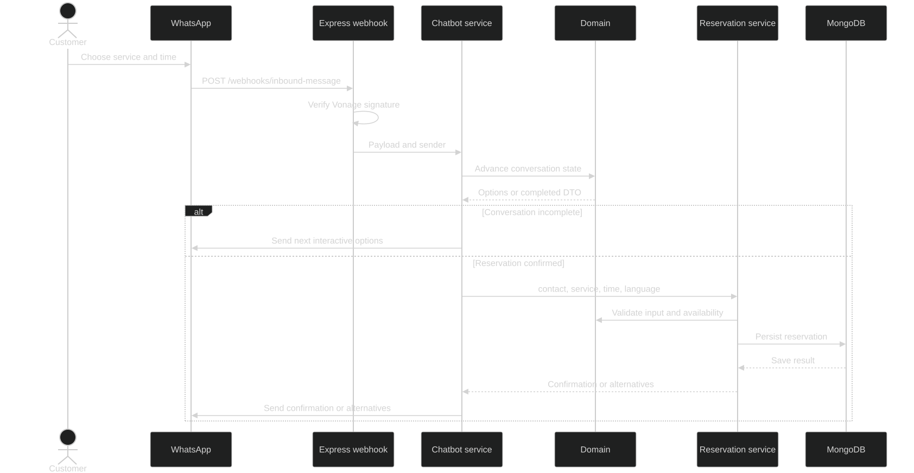
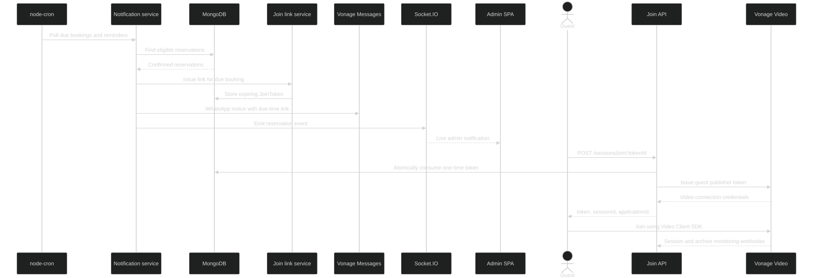

<!-- _class: lead -->
<!-- _paginate: false -->

SYSTEM ARCHITECTURE / 2026

# Video Message Reservation
## From booking to a secure video session

Vonage Video API × WhatsApp × React / Express

 

Architecture overview based on the repository implementation

---

## 1. System overview

**Book through WhatsApp, then join a video session from a secure link when the appointment is due.**

### Customer (WhatsApp)
- Choose a service and time through an interactive chat
- Confirm an available appointment
- Receive reminders and a join link in WhatsApp
- Join the reserved session with a guest token

### Administrator and staff (Web)
- Manage appointments in a React admin console
- Receive live booking and recording status updates
- Operate Vonage Video calls, archives, and transcripts
- Use JWT, role, and assignment-based access control

 

**MongoDB Atlas stores core business data. Vonage Video API provides sessions, recording, and transcription.**

Stack: Node.js / Express · React / Vite · Mongoose · Socket.IO · Vonage Messages and Video APIs

---

## 2. System architecture

REST and Socket.IO share one Node.js HTTP server. The backend can also serve the built SPA.

<!-- Mermaid source: ./slide-assets/architecture.mmd -->

---

## 3. Booking flow

Webhook receipt is acknowledged separately from the chat reply. Conversation state is keyed by sender.

<!-- Mermaid source: ./slide-assets/reservation-sequence.mmd -->

---

## 4. Notifications and joining a video session

node-cron polls due and reminder bookings. WhatsApp and Socket.IO notifications are independent.

<!-- Mermaid source: ./slide-assets/notification-session-sequence.mmd -->

---

## 5. Core data structures

| Entity | Key fields | Purpose |
|---|---|---|
| **Reservation** | `reservationId`, `contact`, `reservationTime`, `service`, `status`, `language`, `sessionId`, `assignedStaffId` | Connects a booking, a video session, and its assigned staff |
| **Notification flags** | `notified`, `reminderSent`, `tenMinReminderSent` | Track delivery independently for each notification type |
| **JoinToken** | `tokenId`, `reservationId`, `sessionId`, `expiresAt`, `consumedAt`, `invalidatedAt` | Expiring, one-time guest access; expired records are removed by MongoDB TTL |
| **SessionPresence** | `sessionId`, `connections[]`, `openedAt`, `closedAt` | Track participants and determine when a room is closed |
| **User** | `userId`, `role`, `passwordHash` | Authenticate `administrator` and `staff`; passwords are bcrypt-hashed |

 

<strong>Note:</strong> DTO stands for <strong>Data Transfer Object</strong>. A reservation DTO carries contact, appointment time, service, and language from the chat to the reservation service.

Reservation statuses: pending / confirmed / cancelled / completed. Languages: en / ja.

In-progress chat state currently lives in a process-local Map keyed by sender, not in persistent storage.

---

## 6. API surface and boundaries

| Area | Main endpoints | Access and behavior |
|---|---|---|
| Authentication | `POST /auth/login` | Public; returns a JWT on success |
| WhatsApp | `POST /webhooks/inbound-message` `POST /webhooks/message-status` | Verify Vonage signatures; handle chat and delivery status |
| Reservations | `GET/POST /reservations` `PATCH/DELETE /reservations/:id` | JWT required; administrator or assigned staff |
| Video access | `POST /sessions/:id/token` `POST /sessions/:id/guest-token` `POST /sessions/join/:tokenId` | Staff JWT, active reservation, or one-time guest link |
| Recording and transcript | `POST /recordings/start` `POST /recordings/:archiveId/stop` `GET /transcriptions/:archiveId` | JWT and action authorization; delegates to Video API |
| Video monitoring | `POST /webhooks/video-events` `POST /webhooks/video-archive-events` | Synchronize room presence and archive status |

 

**Real-time events** use Socket.IO on the same HTTP server (for example, `reservation:due` and `recording:status`), separately from REST responses.

---

## 7. Design strengths

### Separation of concerns
- Pure decisions and transformations in `domain/`
- Application use cases in `services/`
- MongoDB and Vonage adapters in `infra/`
- Dependency injection makes services and routes testable

### Protected integration boundaries
- Signature verification for provider webhooks
- JWT, roles, and staff assignment authorization
- Reservation-backed guest token issuance
- One-time join tokens with expiry and room invalidation

 

### Operationally integrated lifecycle
- Admin Socket.IO updates continue independently of WhatsApp delivery
- Same-origin SPA hosting simplifies mobile join links
- Video recording, transcripts, and monitoring are connected to the admin experience

---

## 8. Improvement opportunities and takeaway

### High priority: multi-instance readiness
Chat state is held in a process-local Map, so restarts and horizontal scaling can lose in-progress conversations. Move it to Redis or another shared store; use distributed coordination and idempotency for scheduled notifications.

### Medium priority: operability
Add structured logs, correlation IDs across webhooks and provider calls, retry handling, and failure/backlog monitoring.

### Medium priority: API and session boundaries
Document request schemas and API contracts, add rate limits, and make webhook replay handling idempotent. Base all staff ownership checks on persisted reservation data.

### Takeaway
**The system unifies booking, messaging, and video-session lifecycle in one business flow** while separating domain, application, and infrastructure responsibilities. Persistent state and distributed execution are the main next steps for scale.

 

Source: repository README and backend/src + frontend/src implementation. Improvement items are recommendations based on the current implementation.

